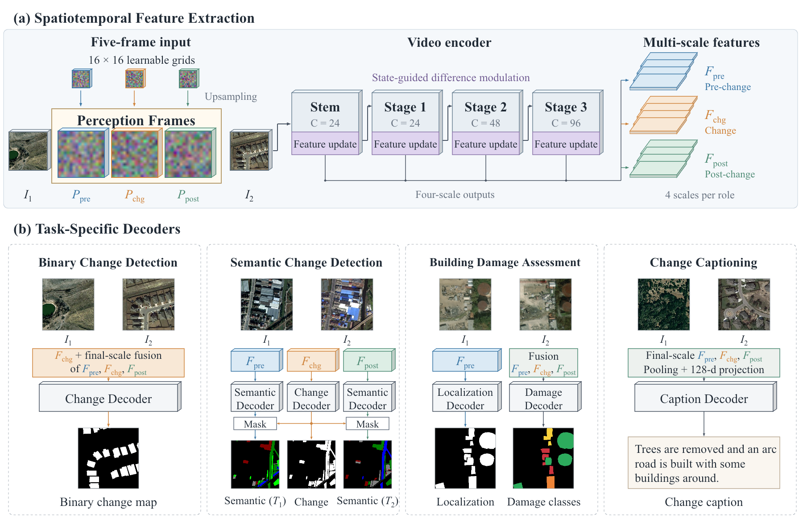

# StateVid

**Lightweight State-Guided Video Modeling for Remote Sensing Change Understanding**

PyTorch implementation of **StateVid**, a compact spatiotemporal encoder with task-specific decoders for binary change detection, semantic change detection, building damage assessment, and change captioning.



[中文说明](README_zh.md) · [Model architecture](docs/model.md) · [Data format](docs/data.md) · [Training and inference](docs/usage.md) · [Configuration reference](docs/configuration.md)

## Overview

Three learnable perception grids form pre-change, change, and post-change frames between a pair of input images. A lightweight video encoder processes the resulting five-frame sequence. State updates and state-guided difference modulation refine features at four scales, and task-specific decoders produce pixel labels or a change description.

The default encoder has feature channels `(24, 24, 48, 96)` and residual-stage depths `(5, 10, 25)`. Complete default models contain approximately **1.60–1.81 million parameters**, depending on the task and vocabulary.

| Task | Dataset configurations |
|---|---|
| Binary change detection | LEVIR-CD, WHU-CD, SYSU-CD, S2Looking |
| Semantic change detection | SECOND, Landsat-SCD, JL1H |
| Building damage assessment | xBD |
| Change captioning | LEVIR-CC, DUBAI-CC |

## Installation

Clone the repository or extract the source archive, then run these commands from the project directory:

```bash
python -m venv .venv
source .venv/bin/activate
python -m pip install --upgrade pip
python -m pip install -e .
```

For CUDA training, use a PyTorch build suited to your GPU and driver. The [official PyTorch installation selector](https://pytorch.org/get-started/locally/) provides platform-specific commands.

Inspect the default BCD model without preparing a dataset:

```bash
statevid-inspect --task bcd --input-size 32
```

Run a small end-to-end CPU example with generated image pairs:

```bash
python scripts/prepare_demo.py --task bcd --output data/demo_bcd --size 32
statevid-train --config configs/demo_bcd.json --output runs/demo_bcd --device cpu
statevid-eval --checkpoint runs/demo_bcd/best.pt \
  --manifest data/demo_bcd/manifest.json --split test --device cpu
```

The demo generator creates its images locally when invoked. The demonstration configuration uses two training updates and exercises the same model and data interfaces as the dataset configurations.

## Prepare a dataset

Store paired images and annotations under `data/`, then describe the train, validation, and test splits in a JSON manifest. All image and label paths are relative to the manifest directory. For example:

```text
data/levir_cd/
├── manifest.json
├── train/
│   ├── A/
│   ├── B/
│   └── label/
├── val/
│   ├── A/
│   ├── B/
│   └── label/
└── test/
    ├── A/
    ├── B/
    └── label/
```

See [data preparation](docs/data.md) for task-specific manifest examples, label definitions, dataset sources, and caption vocabulary settings.

For paired folders following the structure above, create the manifest with:

```bash
python scripts/prepare_manifest.py --task bcd --dataset LEVIR-CD \
  --root data/levir_cd --output data/levir_cd/manifest.json
```

## Train

Select a dataset configuration and set its `manifest` path:

```bash
statevid-train --config configs/bcd_levir_cd.json --output runs/levir_cd --device cuda
```

Other tasks use the same interface:

```bash
statevid-train --config configs/scd_second.json --output runs/second --device cuda
statevid-train --config configs/bda_xbd.json --output runs/xbd --device cuda
statevid-train --config configs/cc_levir_cc.json --output runs/levir_cc --device cuda
```

The supplied configurations initialize the model from scratch. An optional pretrained X3D backbone can be specified with `model.pretrained_backbone`; see [initialization](docs/usage.md#initialization).

For a short run on your prepared dataset:

```bash
statevid-train --config configs/bcd_levir_cd.json --output runs/levir_short --max-steps 10 --device cuda
```

## Evaluate and predict

Evaluate the validation-selected checkpoint on a dataset split:

```bash
statevid-eval --checkpoint runs/levir_cd/best.pt \
  --manifest data/levir_cd/manifest.json --split test \
  --output runs/levir_cd/test_metrics.json --device cuda
```

Predict from one image pair:

```bash
statevid-predict --checkpoint runs/levir_cd/best.pt \
  --pre data/levir_cd/test/A/example.png \
  --post data/levir_cd/test/B/example.png \
  --output predictions/example --device cuda
```

Or process examples from a manifest:

```bash
statevid-predict --checkpoint runs/levir_cd/best.pt \
  --manifest data/levir_cd/manifest.json --split test --limit 3 \
  --output predictions/levir_cd --device cuda
```

All commands are also available through `python -m statevid.cli` using the `train`, `evaluate`, `predict`, and `inspect` subcommands.

## Caption metrics

The base installation provides BLEU-4 and ROUGE-L. Install the caption evaluation extra for the full caption metric suite:

```bash
python -m pip install -e '.[caption]'
```

The complete suite uses `pycocoevalcap`; METEOR also uses a Java runtime. The example caption configurations use the `builtin` backend and select checkpoints using `ROUGE_L`. To use CIDEr selection, set `caption.metric_backend` to `coco` and `train.selection_metric` to `CIDEr`.

## Configurations and ablations

The [configuration reference](docs/configuration.md) describes the model and training options. Complete examples under `configs/ablations/` cover encoder depth, perception-grid size, bottleneck width, state updates, modulation scales, and feature readout.

## Project layout

```text
assets/                 Architecture figure and editable diagram sources
configs/                Dataset and ablation configurations
docs/                   Model, data, and usage documentation
scripts/                Setup and utility scripts
src/statevid/  Models, datasets, losses, metrics, and command-line tools
tests/                  Model and workflow checks
```

## Acknowledgments and license

The architecture builds on [X3D / PyTorchVideo](https://github.com/facebookresearch/pytorchvideo) and [Change3D](https://github.com/zhuduowang/Change3D). Caption evaluation can use [pycocoevalcap](https://github.com/salaniz/pycocoevalcap).

See [LICENSE](LICENSE) and [third-party notices](THIRD_PARTY_NOTICES.md) for licensing and attribution.

## Citation

If this implementation supports your research, cite the accompanying manuscript:

```bibtex
@misc{statevid2026,
  title = {StateVid: Lightweight State-Guided Video Modeling for Remote Sensing Change Understanding},
  author = {Xiangyu Jia and Zhibo Chen and Liping Mu and Zhenyao Wang and Xinpeng Zhang},
  year = {2026}
}
```
