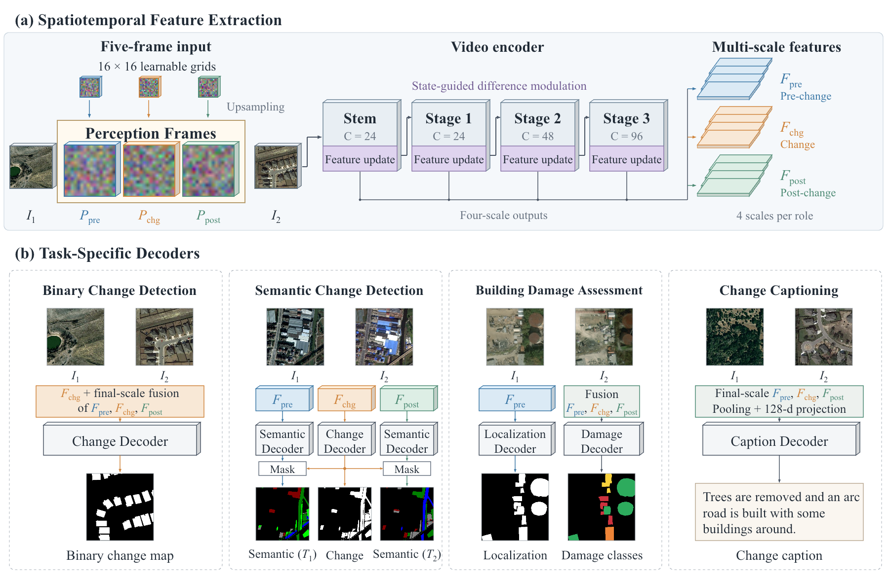

# StateVid

**面向遥感变化理解的轻量状态引导视频建模**

本项目使用共同的时空编码器和任务解码器，支持二值变化检测、语义变化检测、建筑损毁评估和变化描述生成。



[English README](README.md) · [模型结构](docs/model.md) · [数据格式](docs/data.md) · [训练与推理](docs/usage.md) · [配置说明](docs/configuration.md)

## 模型与任务

模型将三张可学习的感知帧插入前后时相影像之间，构成五帧输入。轻量视频编码器在四个尺度提取变化前、变化和变化后三组特征，并通过状态更新和状态引导的差分调制细化变化特征。各任务使用独立训练的解码器输出像素标签或文字描述。

| 任务 | 数据集配置 |
|---|---|
| 二值变化检测 | LEVIR-CD、WHU-CD、SYSU-CD、S2Looking |
| 语义变化检测 | SECOND、Landsat-SCD、JL1H |
| 建筑损毁评估 | xBD |
| 变化描述生成 | LEVIR-CC、DUBAI-CC |

默认模型约有 1.60–1.81M 参数。编码器的四级通道为 `(24, 24, 48, 96)`，三个残差阶段分别包含 `(5, 10, 25)` 个单元。完整逐层结构和参数公式见[模型说明](docs/model.md)。

## 安装

克隆仓库或解压代码后，在项目根目录执行：

```bash
python -m venv .venv
source .venv/bin/activate
python -m pip install --upgrade pip
python -m pip install -e .
```

使用 CUDA 时，可从 [PyTorch 官方安装页](https://pytorch.org/get-started/locally/)选择适合显卡和驱动的构建版本。

先检查模型结构：

```bash
statevid-inspect --task bcd --input-size 32
```

也可以生成小型图像对，在 CPU 上完整走通训练和评估：

```bash
python scripts/prepare_demo.py --task bcd --output data/demo_bcd --size 32
statevid-train --config configs/demo_bcd.json --output runs/demo_bcd --device cpu
statevid-eval --checkpoint runs/demo_bcd/best.pt \
  --manifest data/demo_bcd/manifest.json --split test --device cpu
```

演示图像在运行脚本时生成，使用与正式数据相同的模型和接口，配置只执行两次训练更新。

## 准备数据

将图像和标签放入 `data/`，使用 JSON manifest 描述训练、验证和测试划分。manifest 中的文件路径相对于该 manifest 所在目录，也可以通过 `root` 字段指定数据根目录。

每个样本包含唯一 `id`、前时相图像 `pre`、后时相图像 `post`，以及相应任务的标签：

| 任务 | 标签字段 |
|---|---|
| BCD | `label` |
| SCD | `label_pre`、`label_post` |
| BDA | `localization`、`damage` |
| CC | `captions` |

SCD 的 `num_classes` 包括编号为 0 的未变化类别；`valid_mask` 可标记未标注像素。详细 JSON 示例、类别顺序、数据源和词表设置见[数据文档](docs/data.md)。

已按 `train/A`、`train/B`、`train/label` 等目录准备的数据，可以直接生成 manifest：

```bash
python scripts/prepare_manifest.py --task bcd --dataset LEVIR-CD \
  --root data/levir_cd --output data/levir_cd/manifest.json
```

## 训练

修改配置中的 `manifest`，然后运行：

```bash
statevid-train --config configs/bcd_levir_cd.json --output runs/levir_cd --device cuda
statevid-train --config configs/scd_second.json --output runs/second --device cuda
statevid-train --config configs/bda_xbd.json --output runs/xbd --device cuda
statevid-train --config configs/cc_levir_cc.json --output runs/levir_cc --device cuda
```

配置默认从零初始化。可在 `model.pretrained_backbone` 中指定本地 X3D-L 初始化文件，下载工具和设置方法见[初始化说明](docs/usage.md#initialization)。

通过 `--max-steps` 设置较短的运行预算：

```bash
statevid-train --config configs/bcd_levir_cd.json \
  --output runs/levir_short --max-steps 10 --device cuda
```

通过环境变量选择显卡：

```bash
CUDA_VISIBLE_DEVICES=1 statevid-train \
  --config configs/scd_second.json --output runs/second --device cuda
```

## 评估和预测

评估训练得到的最佳模型：

```bash
statevid-eval --checkpoint runs/levir_cd/best.pt \
  --manifest data/levir_cd/manifest.json --split test \
  --output runs/levir_cd/test_metrics.json --device cuda
```

预测一对图像：

```bash
statevid-predict --checkpoint runs/levir_cd/best.pt \
  --pre path/to/before.png --post path/to/after.png \
  --output predictions/example --device cuda
```

也可以从 manifest 批量导出：

```bash
statevid-predict --checkpoint runs/second/best.pt \
  --manifest data/second/manifest.json --split test --limit 3 \
  --output predictions/second --device cuda
```

命令也可通过 `python -m statevid.cli` 的 `train`、`evaluate`、`predict` 和 `inspect` 子命令调用。

## 变化描述评估

基础安装提供 BLEU-4 和 ROUGE-L。完整评估可安装：

```bash
python -m pip install -e '.[caption]'
```

完整指标使用 `pycocoevalcap`，其中 METEOR 还需要 Java 运行时。默认描述配置使用 `builtin` 后端和 `ROUGE_L` 选择模型；安装完整评估后，将 `caption.metric_backend` 改为 `coco`、`train.selection_metric` 改为 `CIDEr` 即可使用 CIDEr 选模。

## 目录

```text
assets/                   架构图、可编辑幻灯片和 Mermaid 图源
configs/                  十个数据集配置与消融配置
docs/                     模型、数据和运行说明
scripts/                  辅助工具
src/statevid/ 模型、数据、损失、指标与命令行入口
tests/                    模型与工作流检查
```

架构图另有[可编辑 PowerPoint](assets/architecture_editable.pptx)和[Mermaid 源文件](assets/architecture.mmd)。

## 引用与许可

模型基于 X3D / PyTorchVideo 和 Change3D，第三方实现的来源及许可保留在随代码分发的说明中。使用条款见 [LICENSE](LICENSE)。

使用本实现开展研究时，请引用配套论文：

> **StateVid: Lightweight State-Guided Video Modeling for Remote Sensing Change Understanding**
