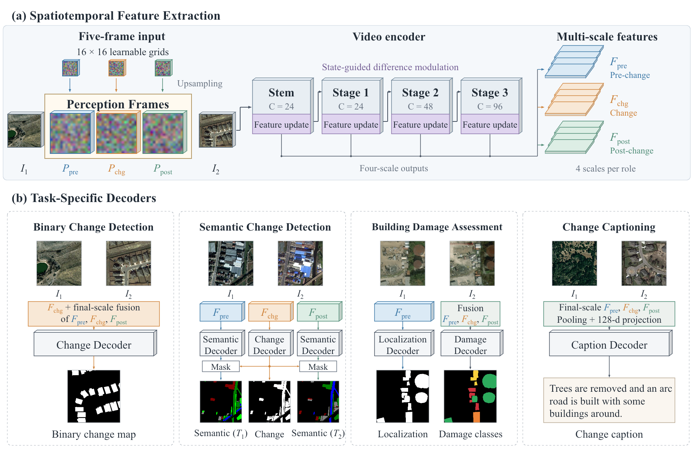

# StateVid architecture

StateVid uses one spatiotemporal encoder design with task-specific readouts. A separate model is trained for each dataset.



The repository includes the [editable architecture slide](../assets/architecture_editable.pptx) and a [Mermaid source diagram](../assets/architecture.mmd).

## Five-frame representation

Given two RGB images of shape `B × 3 × H × W`, three learnable RGB grids of spatial size `16 × 16` are resized to `H × W` with bilinear interpolation. The model stacks the images and perception frames along the temporal axis:

```text
[I1, P_pre, P_chg, P_post, I2]  ->  B × 3 × 5 × H × W
```

The grids contribute 2,304 learned parameters. They are shared across samples.

## Encoder

The encoder preserves all five temporal positions. Its stem preserves spatial resolution, and each residual stage downsamples space by two. For inputs divisible by eight:

| Scale | Encoder component | Channels | Spatial size | Residual units | Bottleneck channels |
|---|---|---:|---|---:|---:|
| 1 | Spatial `1 × 3 × 3` convolution and depthwise temporal `5 × 1 × 1` convolution | 24 | `H × W` | — | — |
| 2 | Residual stage 1 | 24 | `H/2 × W/2` | 5 | 54 |
| 3 | Residual stage 2 | 48 | `H/4 × W/4` | 10 | 108 |
| 4 | Residual stage 3 | 96 | `H/8 × W/8` | 25 | 216 |

A residual unit applies a pointwise 3D convolution, a depthwise `3 × 3 × 3` convolution, and a pointwise 3D projection. Affine batch normalization follows each convolution. Squeeze-and-excitation modules appear in odd-numbered residual units within each stage. The first unit in each stage uses spatial stride two; all other units use stride one.

## State-guided difference modulation

An update module follows the stem and every residual stage. Let `V1` and `V2` be the encoded image-position features, and let `Q_pre`, `Q_chg`, and `Q_post` be the three perception-position features. Each scale computes:

```text
D       = V2 - V1
S_pre   = Q_pre  + alpha_s * A(V1)
S_post  = Q_post + alpha_s * A(V2)
Q_bar   = Q_chg  + H(abs(D))

N_s, N_d = split(GroupNorm(concat(S_pre, S_post, abs(D), D)))
M         = 1 + tanh(phi_s(N_s))
D_active  = ReLU(phi_d(N_d))
S_chg     = Q_bar + alpha_c * phi_o(D_active * M)
```

`A` and `H` are separate bias-free `1 × 1` convolutions followed by ReLU. `A` is shared by the pre- and post-state updates within a scale. Group normalization uses four groups without learned affine parameters. The two input projections map `2C → C/4`, and the output projection maps `C/4 → C`. The residual scalars are learned. Different scales have separate update parameters.

The updated pre-, change-, and post-features are returned to their temporal positions before the next encoder stage. Their features are collected at all four scales.

## Dense prediction readouts

Each dense decoder starts at scale four and performs three upsampling steps. Every step applies a `1 × 1` channel projection and a `4 × 4`, stride-two transposed convolution, then adds the corresponding finer-scale feature. A final `3 × 3` convolution produces the task output.

| Task | Readout | Output |
|---|---|---|
| Binary change detection | Change features at scales 1–3; concatenated pre/change/post features projected `288 → 96` at scale 4 | One-channel change logits |
| Semantic change detection | Independent pre-state and post-state decoders, plus a change decoder | Two `K`-channel semantic maps and one binary change map |
| Building damage assessment | Pre-state decoder for localization; scale-wise concatenation of all three roles followed by `3C → C` projection for damage classification | Localization logits and five-channel damage logits |

Binary decisions use a sigmoid threshold of `0.5`. Semantic and damage decisions use channel-wise argmax. Semantic outputs are gated by the model's predicted change mask. A damage visualization can use the model's predicted localization mask.

## Change captioning readout

The caption model concatenates the three final-scale role features, pools them to `8 × 8`, and projects `288 → 128` channels. This produces 64 visual tokens. Fixed 2D sine/cosine positions and layer normalization are applied to the visual tokens.

The language decoder uses:

| Setting | Value |
|---|---:|
| Decoder layers | 1 |
| Model dimension | 128 |
| Attention heads | 4 |
| Feed-forward dimension | 256 |
| Dropout | 0.1 |
| Maximum sequence length | 52, including special tokens |
| Visual memory grid | `8 × 8` |
| Default beam size | 3 |

Input word embeddings and the output vocabulary projection share a weight matrix. Learned word positions are added before causal self-attention. Cross-attention connects the word tokens to the visual memory.

Both caption datasets use `256 × 256` model inputs. DUBAI-CC's original `50 × 50` RGB images are resized with bilinear interpolation before ImageNet normalization.

## Parameter counts

Counts include the full inference model. Caption counts use the vocabulary sizes below.

| Configuration | Output specification | Parameters |
|---|---|---:|
| BCD | One binary channel | 1,601,128 |
| SCD / SECOND | `K = 7` | 1,699,960 |
| SCD / Landsat-SCD | `K = 5` | 1,699,096 |
| SCD / JL1H | `K = 6` | 1,699,528 |
| BDA / xBD | One localization channel and five damage channels | 1,674,304 |
| CC / LEVIR-CC | `V = 404` | 1,806,468 |
| CC / DUBAI-CC | `V = 297` | 1,792,665 |

The shared core contains 1,511,536 parameters. A dense decoder with `K` output channels contains `61,728 + 216K` parameters. The caption head contains `242,816 + 129V` parameters.

## Training objectives

| Task | Objective |
|---|---|
| BCD | Binary cross-entropy and Dice loss |
| SCD | Endpoint semantic cross-entropy, binary change cross-entropy, Dice loss, and semantic cosine consistency |
| BDA | Localization binary cross-entropy and Dice loss, plus damage cross-entropy |
| CC | Teacher-forced token cross-entropy over non-padding targets, including the end token |

SCD semantic cross-entropy uses nonzero ground-truth endpoint labels. Its consistency term encourages agreement in unchanged regions, penalizes similarity for changes between different classes, and excludes same-class changed pixels from the repulsive term. Optional cached pseudo labels add semantic supervision at accepted original unchanged pixels; their preparation is described in the [data guide](data.md#cached-pseudo-labels).

BDA damage cross-entropy includes background and the four damage categories. Unclassified building pixels retain localization supervision and are ignored by damage cross-entropy.
